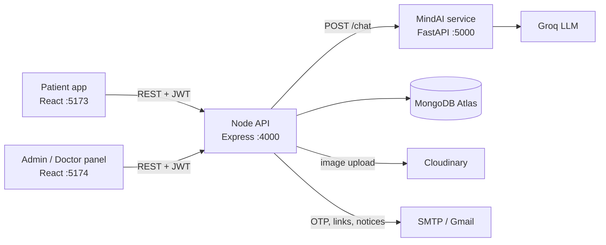
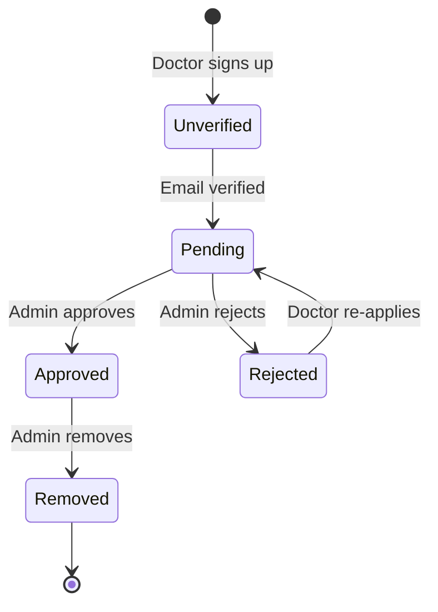
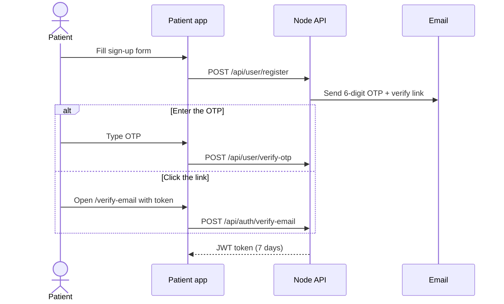
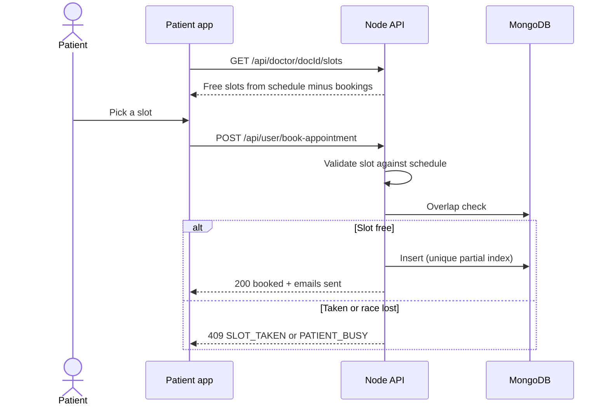
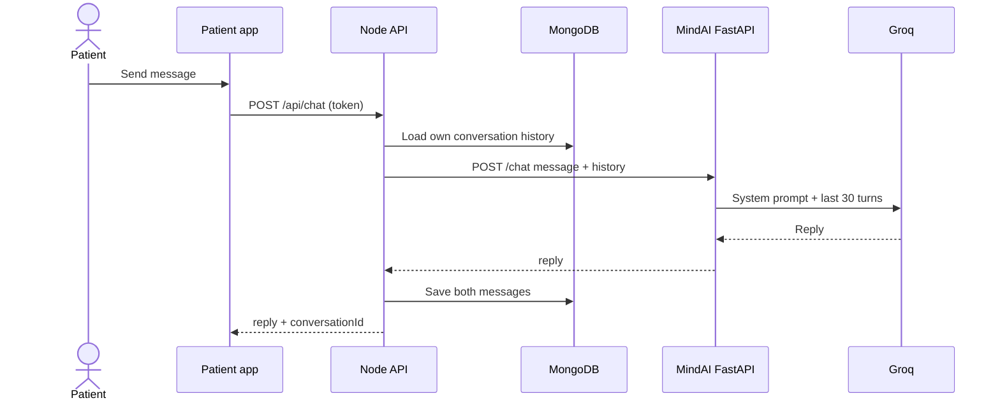
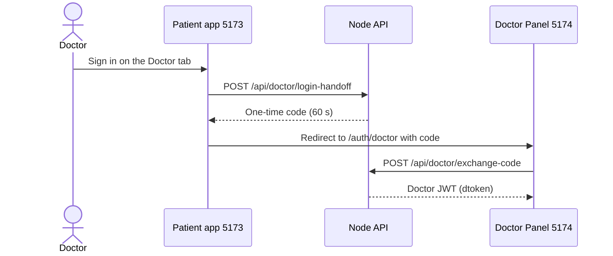

<div align="center">

# MindCare

**An AI mental-health companion plus verified-doctor booking and hospital administration, all in one platform.**


</div>

---

## Table of contents

1. [Overview](#overview)
2. [Features](#features)
3. [Tech stack](#tech-stack)
4. [Architecture](#architecture)
5. [Workflows](#workflows)
6. [Project structure](#project-structure)
7. [Prerequisites](#prerequisites)
8. [Installation](#installation)
9. [Environment variables](#environment-variables)
10. [Running](#running)
11. [First-time walkthrough](#first-time-walkthrough)
12. [Optional one-time scripts](#optional-one-time-scripts)
13. [API overview](#api-overview)
14. [Security and design decisions](#security-and-design-decisions)
15. [Build and deployment](#build-and-deployment)
16. [Troubleshooting](#troubleshooting)
17. [Roadmap](#roadmap)
18. [Author](#author)
19. [License](#license)

---

## Overview

Getting mental-health help is hard. People don't know where to start, they worry about stigma, and booking a qualified psychiatrist often means phone calls and waiting. MindCare puts three things in one place:

- **MindAI**, an AI support companion that talks with patients in **English, Urdu and Roman Urdu**. It answers in the language of the patient's last message, remembers the conversation, and follows a crisis protocol that points people to professional help.
- **Verified-doctor booking.** Doctors apply and verify their email, and an admin approves them before they appear to patients. Patients book real time slots that the server generates from each doctor's weekly schedule.
- **Hospital administration.** One panel for the admin to review doctor applications, manage doctors and appointments, and see dashboard stats. Approved doctors use the same panel to run their day.

---

## Features

### Patient (`frontend/`, port 5173)
- Sign up with a 6-digit email OTP **or** a one-click verify link, sign in, and reset a forgotten password by email
- Browse doctors by speciality and see their **live availability**, generated by the server from each doctor's schedule
- Book a slot. The server prevents double booking with a 409 response plus unique indexes.
- View and cancel appointments, and edit their profile and photo
- Chat with **MindAI**: history in a sidebar, suggested prompts, delete one conversation or all of them
- Light and dark theme

### Doctor (signs up in `frontend/`, works in `admin/`)
- **Sign up → verify email → application pending → admin approves**, with an application-status page and re-apply after a rejection
- **Doctor Panel**
  - **Dashboard**: today's schedule, earnings, appointment and patient counts
  - **My Patients**: list plus per-patient history
  - **Appointments**: mark as completed, no-show, or cancel
  - **My Schedule**: weekly working hours, slot length, booking window, time-off
  - **Profile**: fee, address, about, photo, availability
- Forgot / reset password by email

### Admin (`admin/`, port 5174)
- **Doctor requests**: approve or reject (with a reason) pending applications
- **Doctors list**: toggle availability, add a doctor directly, **remove** a doctor (soft delete that keeps their appointment history), or hard-delete one only if they have no appointments
- **Appointments**: view and cancel all of them
- **Dashboard**: counts of doctors, appointments and patients, plus the latest bookings

### MindAI (`backend/chatbot/`, port 5000)
- **Crisis protocol**: recognises self-harm and crisis language and steers the patient to immediate professional help
- **Language matching**: English / Urdu / Roman Urdu, mirroring the patient's last message
- **Memory**: conversations are stored per user in MongoDB, and the last 30 turns are sent as context
- **Conversation delete**: one conversation or all of them; the owner only
- Stays on topic (mental health and emotional support)

---

## Tech stack

| Layer | Technology |
| --- | --- |
| Patient app | React 19, Vite 7, Tailwind CSS v4, React Router 7, react-toastify, react-markdown |
| Admin / Doctor panel | React 19, Vite 7, Tailwind CSS v4, React Router 7 |
| API | Node.js, Express 5, Mongoose 8, JWT, Multer, Nodemailer, Luxon |
| AI service | Python 3.10+, FastAPI, Uvicorn, LangChain + Groq |
| Database | MongoDB Atlas |
| Media | Cloudinary |
| Email | Gmail App Password (default) or any SMTP provider |

---

## Architecture



The Node API is the only component that talks to the database. The MindAI service is **stateless**: Node sends it the message and the recent history, and it returns a reply.

---

## Workflows

### Doctor lifecycle



Only `approved` doctors can sign in to the Doctor Panel or appear in the patient app. The status is checked on **every** request, so a removal takes effect at once.

### Patient signup (OTP + verify link)



### Appointment booking with double-booking protection



### MindAI chat



### Doctor login hand-off (patient app to Doctor Panel)



No token ever appears in a URL. The code is single-use and expires after 60 seconds.

---

## Project structure

```
MindCare/
├── admin/                    # Admin + Doctor panel (Vite React, :5174)
│   ├── public/
│   └── src/
│       ├── components/       # Navbar, Sidebar, ui/ primitives
│       ├── context/          # AdminContext, DoctorContext, AppContext
│       ├── pages/
│       │   ├── Admin/        # Dashboard, DoctorRequests, DoctorsList, AllAppointments, AddDoctor
│       │   └── Doctor/       # Dashboard, Patients, Appointments, Schedule, Profile
│       └── styles/           # theme.css, motion.css, components.css
├── frontend/                 # Patient app (Vite React, :5173)
│   ├── context/AppContext.jsx
│   ├── public/
│   └── src/
│       ├── components/       # Navbar, Footer, Banner, DoctorSignup, ui/
│       ├── pages/            # Home, Doctors, Appointment, MyAppointments, ChatBot, Login, ...
│       ├── config.js         # env-driven site config
│       └── styles/
├── backend/
│   ├── chatbot/main.py       # MindAI FastAPI service (:5000)
│   ├── config/               # mongodb.js, cloudinary.js, mailer.js
│   ├── controllers/          # admin, auth, chat, doctor, doctorAuth, user
│   ├── emails/               # branded HTML email layout + templates
│   ├── middlewares/          # authAdmin, authDoctor, authUser, multer
│   ├── models/               # user, doctor, appointment, conversation, chat
│   ├── routes/               # adminRoute, authRoute, chatRoute, doctorRoute, userRouter
│   ├── scripts/              # migrate.mjs, upload-email-logo.mjs
│   ├── services/             # scheduling, appointments, notify, security
│   ├── requirements.txt
│   └── server.js             # Express entry (:4000)
├── LICENSE
└── README.md
```

---

## Prerequisites

- **Node.js 20+** and npm
- **Python 3.10+**
- **Git**

Accounts you need (all have free tiers):

| Service | What for | How to get it |
| --- | --- | --- |
| MongoDB Atlas | Database | Create a free cluster, add a database user, allow your IP under *Network Access*, and copy the `mongodb+srv://` string. |
| Cloudinary | Doctor and profile images | Sign up, then copy the Cloud name, API key and API secret from the dashboard. |
| Gmail App Password | Sending OTP and notification emails | Turn on 2-Step Verification, then go to Google Account → Security → *App passwords* and create one (16 chars). |
| Groq | MindAI LLM | Sign up at console.groq.com and create an API key. |

---

## Installation

**Windows (PowerShell)**

```powershell
git clone https://github.com/TalhaRehman-KHT/MindCare.git
cd MindCare

cd backend;  npm install
python -m venv venv
.\venv\Scripts\pip install -r requirements.txt
Copy-Item .env.example .env
cd ..\frontend;  npm install;  Copy-Item .env.example .env
cd ..\admin;     npm install;  Copy-Item .env.example .env
```

**Linux / macOS**

```bash
git clone https://github.com/TalhaRehman-KHT/MindCare.git
cd MindCare

cd backend && npm install
python3 -m venv venv
./venv/bin/pip install -r requirements.txt
cp .env.example .env
cd ../frontend && npm install && cp .env.example .env
cd ../admin && npm install && cp .env.example .env
```

Then fill in the three `.env` files (see below). **Never commit `.env` files**; they are git-ignored.

---

## Environment variables

### `backend/.env`

| Name | Required | Description | Example |
| --- | --- | --- | --- |
| `PORT` | no | Node API port | `4000` |
| `MONGODB_URL` | **yes** | MongoDB Atlas connection string | `mongodb+srv://<user>:<password>@<cluster>/<db>` |
| `JWT_SECRET` | **yes** | Secret that signs every JWT | long random string |
| `ADMIN_EMAIL` | **yes** | Admin login email (no fallback) | `admin@example.com` |
| `ADMIN_PASSWORD` | **yes** | Admin login password | `change-me` |
| `CLOUDINARY_NAME` | **yes** | Cloudinary cloud name | `your-cloud-name` |
| `CLOUDINARY_API_KEY` | **yes** | Cloudinary API key | `your-cloudinary-api-key` |
| `CLOUDINARY_SECRET_KEY` | **yes** | Cloudinary API secret | `your-cloudinary-api-secret` |
| `EMAIL_USER` | **yes** | Sender mailbox | `you@gmail.com` |
| `EMAIL_PASS` | **yes** | Gmail App Password / SMTP password | `your-gmail-app-password` |
| `MAIL_FROM_NAME` | no | Display name on emails | `"MindCare"` |
| `SUPPORT_EMAIL` | no | Reply-to and footer address | `support@example.com` |
| `EMAIL_LOGO_URL` | no | https logo for emails | Cloudinary URL |
| `MAIL_SERVICE` | no | Nodemailer service name | `gmail` |
| `SMTP_HOST` / `SMTP_PORT` / `SMTP_SECURE` / `SMTP_USER` / `SMTP_PASS` | no | Generic SMTP provider; overrides Gmail when `SMTP_HOST` is set | `smtp.your-provider.com` / `587` / `false` |
| `MAIL_FROM_ADDRESS` | no | Verified sender at your SMTP provider | `noreply@your-domain.com` |
| `PATIENT_APP_URL` | no | Patient app base URL, used in email links | `http://localhost:5173` |
| `ADMIN_PANEL_URL` | no | Admin panel base URL, used in hand-off and emails | `http://localhost:5174` |
| `CLINIC_TZ` | no | Time zone for doctor schedules | `Asia/Karachi` |
| `CHATBOT_URL` | no | Where Node reaches MindAI | `http://127.0.0.1:5000` |
| `CHATBOT_HOST` / `CHATBOT_PORT` | no | MindAI bind address | `127.0.0.1` / `5000` |
| `CHATBOT_LLM_TIMEOUT` | no | LLM timeout in seconds | `45` |
| `GROQ_API_KEY` | **yes** (for MindAI) | Groq API key | `your-groq-api-key` |
| `GROQ_MODEL` | no | Groq model id | `openai/gpt-oss-120b` (default) |

### `frontend/.env`

| Name | Required | Description | Example |
| --- | --- | --- | --- |
| `VITE_BACKEND_URL` | **yes** | Node API URL | `http://localhost:4000` |
| `VITE_ADMIN_PANEL_URL` | no | Doctor Panel URL, used for the login hand-off | `http://localhost:5174` |
| `VITE_CLINIC_TZ` | no | Time zone for displaying slots | `Asia/Karachi` |
| `VITE_SUPPORT_EMAIL` | no | Public contact email (Footer and Contact page) | `support@example.com` |
| `VITE_SUPPORT_PHONE` | no | Public contact phone | `+92 000 0000000` |

### `admin/.env`

| Name | Required | Description | Example |
| --- | --- | --- | --- |
| `VITE_BACKEND_URL` | **yes** | Node API URL | `http://localhost:4000` |
| `VITE_PATIENT_APP_URL` | no | Patient app URL (links back) | `http://localhost:5173` |
| `VITE_CLINIC_TZ` | no | Time zone for displaying slots | `Asia/Karachi` |

---

## Running

| Service | Folder | Command | URL |
| --- | --- | --- | --- |
| Node API + MindAI together | `backend/` | `npm run dev` (nodemon + chatbot via concurrently, Windows venv path) | http://localhost:4000 and http://127.0.0.1:5000 |
| Node API only | `backend/` | `npm start` | http://localhost:4000 |
| MindAI only | `backend/` | `npm run chatbot` (Windows) or `./venv/bin/python -m chatbot.main` (Linux/macOS) | http://127.0.0.1:5000 |
| Patient app | `frontend/` | `npm run dev` | http://localhost:5173 |
| Admin / Doctor panel | `admin/` | `npm run dev` | http://localhost:5174 |

> On Linux/macOS, `npm run dev` / `npm run chatbot` in `backend/` use the Windows path `venv\Scripts\python`. Run `npx nodemon server.js` and `./venv/bin/python -m chatbot.main` in two terminals instead.

**Expected startup logs (Node API):**

```
SERVER IS LISTENING ON PORT http://localhost:4000
DATABASE CONNECTED
SMTP READY (gmail ...)
INDEXES appointment: ok [...]
```

**Health checks**

- `GET http://localhost:4000/` returns `MindAI backend Working`
- `GET http://127.0.0.1:5000/health` returns `{"status":"ok","model":...}` (`?deep=1` also pings Groq)

---

## First-time walkthrough

1. **Admin login.** Open http://localhost:5174 and sign in with `ADMIN_EMAIL` / `ADMIN_PASSWORD`.
2. **Doctor signs up.** In the patient app (http://localhost:5173), go to *Login → Doctor → Sign up*, fill in the profile, and verify the email with the OTP or the link. The application is now **pending**.
3. **Admin approves.** In the admin panel, open *Doctor Requests* and click **Approve**. The doctor gets an email.
4. **Doctor sets a schedule.** The doctor signs in from the patient app's Doctor tab and is handed off to the Doctor Panel, then sets working hours under *My Schedule*.
5. **Patient books.** Sign up as a patient, verify, open the doctor's page, and pick a free slot.
6. **Doctor sees it.** The booking appears on the doctor's *Dashboard* (today's schedule) and under *Appointments* and *My Patients*.
7. **Chat with MindAI.** As the patient, open *MindAI* and send a message in English, Urdu or Roman Urdu.

---

## Optional one-time scripts

Run from `backend/`:

| Script | Purpose |
| --- | --- |
| `node scripts/migrate.mjs` | **Dry run** (default): prints what would change when legacy appointments/doctors move to the current schema |
| `node scripts/migrate.mjs --apply` | Applies the migration, then builds the unique indexes |
| `node scripts/upload-email-logo.mjs [path]` | Uploads the MindCare logo to Cloudinary and prints the URL to put in `EMAIL_LOGO_URL` |

---

## API overview

Base URL: `http://localhost:4000`. Auth is sent in request **headers**: `token` (patient), `dtoken` (doctor), `atoken` (admin), `apptoken` (doctor applicant).

<details>
<summary><b>/api/user</b>: patients</summary>

| Method | Path | Auth | Purpose |
| --- | --- | --- | --- |
| POST | `/api/user/register` | | Create account, send OTP + verify link |
| POST | `/api/user/verify-otp` | | Verify email with OTP, returns token |
| POST | `/api/user/resend-otp` | | Resend OTP (60 s cooldown) |
| POST | `/api/user/login` | | Sign in |
| GET | `/api/user/get-profile` | `token` | Get own profile |
| POST | `/api/user/update-profile` | `token` | Update profile (multipart `img`) |
| POST | `/api/user/book-appointment` | `token` | Book `{docId, startAt}`; 409 on clash |
| POST | `/api/user/appointments` | `token` | List own appointments |
| POST | `/api/user/cancel-appointment` | `token` | Cancel own appointment |
| POST | `/api/user/forgot-password` | | Email reset link |
| POST | `/api/user/reset-password/:token` | | Set new password |

</details>

<details>
<summary><b>/api/auth</b>: shared</summary>

| Method | Path | Auth | Purpose |
| --- | --- | --- | --- |
| POST | `/api/auth/verify-email` | | Verify a link token `{token, type: "user" or "doctor"}` |

</details>

<details>
<summary><b>/api/doctor</b>: doctors</summary>

| Method | Path | Auth | Purpose |
| --- | --- | --- | --- |
| GET | `/api/doctor/list` | | Public list of approved doctors |
| GET | `/api/doctor/:docId/slots` | | Free slots for a doctor |
| POST | `/api/doctor/register` | | Apply (multipart `image`) |
| POST | `/api/doctor/verify-otp` | | Verify email with OTP |
| POST | `/api/doctor/resend-otp` | | Resend OTP |
| POST | `/api/doctor/login` | | Sign in directly in the panel |
| POST | `/api/doctor/login-handoff` | | Sign in from the patient app, returns a one-time code |
| POST | `/api/doctor/exchange-code` | | Swap the one-time code for `dtoken` |
| GET / POST | `/api/doctor/application-status` | | Application status (pending / rejected reason) |
| POST | `/api/doctor/reapply` | `apptoken` | Resubmit a rejected application |
| POST | `/api/doctor/forgot-password` | | Email reset link |
| POST | `/api/doctor/reset-password/:token` | | Set new password |
| GET | `/api/doctor/dashboard` | `dtoken` | Stats + today's schedule |
| GET | `/api/doctor/appointments` | `dtoken` | Own appointments |
| POST | `/api/doctor/complete-appointment` | `dtoken` | Mark completed |
| POST | `/api/doctor/no-show-appointment` | `dtoken` | Mark no-show |
| POST | `/api/doctor/cancel-appointment` | `dtoken` | Cancel |
| GET | `/api/doctor/patients` | `dtoken` | My Patients |
| GET | `/api/doctor/patients/:userId` | `dtoken` | One patient's history with me |
| GET | `/api/doctor/profile` | `dtoken` | Own profile |
| POST | `/api/doctor/update-profile` | `dtoken` | Update profile (multipart `image`) |
| GET | `/api/doctor/schedule` | `dtoken` | Weekly schedule + time-off |
| PUT | `/api/doctor/schedule` | `dtoken` | Update schedule |
| POST | `/api/doctor/time-off` | `dtoken` | Add time-off |
| DELETE | `/api/doctor/time-off/:id` | `dtoken` | Remove time-off |

</details>

<details>
<summary><b>/api/admin</b>: hospital admin</summary>

| Method | Path | Auth | Purpose |
| --- | --- | --- | --- |
| POST | `/api/admin/login` | | Admin sign-in (env credentials) |
| GET | `/api/admin/dashboard` | `atoken` | Counts + latest bookings |
| GET | `/api/admin/doctor-requests` | `atoken` | Pending applications |
| POST | `/api/admin/approve-doctor` | `atoken` | Approve |
| POST | `/api/admin/reject-doctor` | `atoken` | Reject with a reason |
| GET / POST | `/api/admin/all-doctors` | `atoken` | All doctors |
| POST | `/api/admin/add-doctor` | `atoken` | Add an approved doctor directly (multipart `image`) |
| POST | `/api/admin/change-availability` | `atoken` | Toggle availability |
| POST | `/api/admin/remove-doctor` | `atoken` | Soft delete (status `removed`) |
| POST | `/api/admin/delete-doctor` | `atoken` | Hard delete (only if no appointments) |
| GET | `/api/admin/appointments` | `atoken` | All appointments |
| POST | `/api/admin/cancel-appointment` | `atoken` | Cancel any appointment |

</details>

<details>
<summary><b>/api/chat</b>: MindAI</summary>

| Method | Path | Auth | Purpose |
| --- | --- | --- | --- |
| POST | `/api/chat` | `token` | Send a message (new or existing conversation) |
| GET | `/api/chat/conversations` | `token` | Sidebar list of own conversations |
| GET | `/api/chat/:conversationId` | `token` | Messages of one own conversation |
| DELETE | `/api/chat/:conversationId` | `token` | Delete one own conversation |
| DELETE | `/api/chat` | `token` | Delete all own conversations |

MindAI service (internal, called by Node only): `GET /health`, `POST /chat {message, history}` returns `{reply}`.

</details>

---

## Security and design decisions

| Decision | Why |
| --- | --- |
| **Server-generated slots** in UTC, interpreted in `CLINIC_TZ` (Asia/Karachi) | Clients can't invent times, and time zones stay correct for every viewer |
| **Unique partial indexes** on active appointments (per doctor and per patient) | The final guard against double booking under race conditions, returned as a 409 |
| **Doctor approval workflow** (pending → approved / rejected) | Only verified, admin-approved doctors are visible and bookable |
| **Soft delete** (`removed`) | Removing a doctor keeps appointment history intact; hard delete only works when there are no appointments |
| **Status check on every doctor request** | A removed or un-approved doctor loses access immediately, even with a valid JWT |
| **One-time hand-off code** (60 s, single use) | Moves a doctor login between apps without putting a token in a URL |
| **Hashed OTPs and tokens** (SHA-256), 5 attempts, 60 s resend cooldown | A database leak doesn't expose usable codes, and brute force is limited |
| **JWT expiry**: patient and doctor 7 days, admin 1 day | Limits how long a stolen token is useful |
| **Admin credentials only from env** | No hardcoded fallback, and the admin JWT doesn't embed credentials |
| **Chat isolation per user** | Every chat query is scoped to the authenticated `userId`; only owners can read or delete |
| **POST verify link** | The `/verify-email` page posts the token, so email link scanners (GET) can't consume it |
| **Stateless AI service** | MindAI holds no data; Node owns persistence, so the AI service can scale or restart freely |

---

## Branches
- `main`: integration & testing. Open all pull requests here.
- `dev`: **production / live deployment**. Updated only by the maintainer via a PR from `main`; every deploy needs manual approval.

## Build and deployment

```bash
cd frontend && npm run build   # → frontend/dist
cd admin && npm run build      # → admin/dist
```

- Serve both `dist/` folders as static SPAs (Vercel, Netlify, Nginx), with a fallback to `index.html` for client-side routes.
- Run the Node API with `npm start` (behind a process manager such as PM2) and MindAI with `uvicorn chatbot.main:app --host 0.0.0.0 --port 5000`.
- Production env: set `VITE_BACKEND_URL`, `VITE_ADMIN_PANEL_URL` and `VITE_PATIENT_APP_URL` to your public URLs **before** building (Vite inlines them), and set `PATIENT_APP_URL`, `ADMIN_PANEL_URL` and `CHATBOT_URL` in `backend/.env`.
- Use a strong `JWT_SECRET`, restrict Atlas network access to your server IPs, and restrict CORS to your domains.

---

## Troubleshooting

| Symptom | Fix |
| --- | --- |
| `DATABASE ERROR: bad auth` | Check the Atlas database user and password in `MONGODB_URL`; URL-encode special characters |
| `DATABASE ERROR` timeout / `querySrv ENOTFOUND` | Add your IP under Atlas → Network Access; check DNS or VPN (try DNS 8.8.8.8) |
| SMTP `535 Username and Password not accepted` | Use a Gmail **App Password** (2-Step Verification required), not your normal password |
| Chat says MindAI is unavailable | Start the chatbot (`npm run chatbot`) and check `CHATBOT_URL` and `GET :5000/health` |
| Groq `401 Invalid API Key` | Fix `GROQ_API_KEY` in `backend/.env` and restart MindAI |
| Doctor can't sign in ("pending") | The application must be approved under Admin → Doctor Requests |
| Build fails on Linux only | Imports are case-sensitive on Linux; match file names exactly |
| `INDEXES ... FAILED` on startup | Legacy duplicate data. Run `node scripts/migrate.mjs`, then `--apply` |

---

## Roadmap

- [ ] Online payments for appointment fees
- [ ] Video consultations
- [ ] Appointment reminders (email / SMS)
- [ ] MindAI streaming responses and voice input
- [ ] Docker Compose for one-command local setup
- [ ] CI pipeline with automated tests and linting
- [ ] Multi-hospital support

---

## Author

**Talha Rehman**

- Portfolio: https://talha-five.vercel.app
- LinkedIn: https://www.linkedin.com/in/talha-rehman-460014218
- GitHub: https://github.com/TalhaRehman-KHT

---

## License

[MIT](LICENSE) © 2026 Talha Rehman

> **Medical disclaimer:** MindAI is an AI support companion, **not** a substitute for professional diagnosis, treatment or care. If you or someone you know is in crisis or in danger, contact your local emergency services or a crisis helpline immediately.
